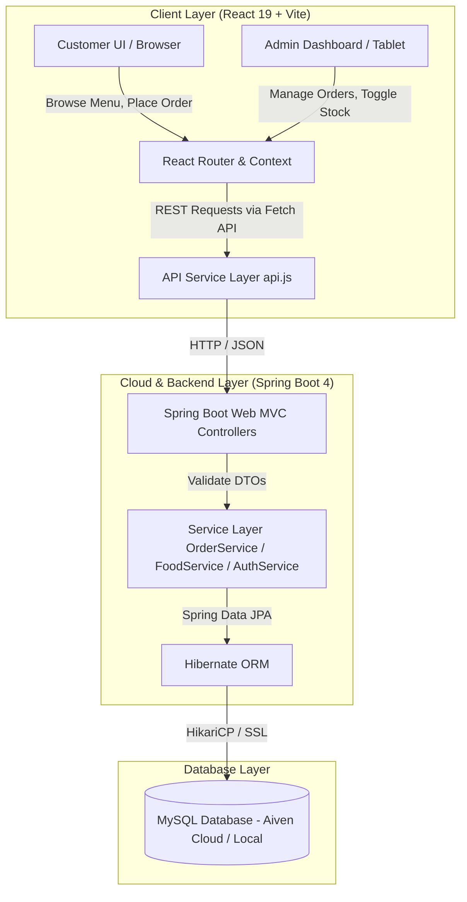
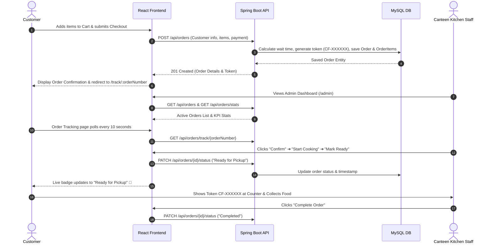

# 🍽️ CanteenFlow

> **Smart Campus & Cafeteria Food Ordering & Kitchen Management System**  
> A full-stack web application designed to eliminate long canteen queues, streamline kitchen order workflows, and provide students and staff with live order tracking.

[](https://react.dev/)
[](https://vitejs.dev/)
[](https://www.oracle.com/java/)
[](https://spring.io/projects/spring-boot)
[](https://www.mysql.com/)
[](https://render.com/)
[](https://vercel.com/)

---

## 📌 Table of Contents

- [Overview](#-overview)
- [Key Features](#-key-features)
  - [Customer / Student Experience](#customer--student-experience)
  - [Canteen Staff & Kitchen Admin Dashboard](#canteen-staff--kitchen-admin-dashboard)
- [System Architecture](#-system-architecture)
- [Order Lifecycle Flow](#-order-lifecycle-flow)
- [Tech Stack](#-tech-stack)
- [Database Schema & Data Models](#-database-schema--data-models)
- [API Reference](#-api-reference)
  - [Authentication](#authentication-apis)
  - [Food Items (Menu)](#food-items-apis)
  - [Orders](#orders-apis)
- [Project Directory Structure](#-project-directory-structure)
- [Default Demo Credentials](#-default-demo-credentials)
- [Local Development Setup](#-local-development-setup)
  - [Prerequisites](#prerequisites)
  - [1. Backend Setup](#1-backend-setup-spring-boot)
  - [2. Frontend Setup](#2-frontend-setup-react--vite)
  - [3. Running via Batch Scripts (Windows)](#3-running-via-one-click-batch-scripts-windows)
- [Environment Variables](#-environment-variables)
- [Cloud Deployment Guide](#-cloud-deployment-guide)
- [License](#-license)

---

## 🌟 Overview

During rush hours in colleges and corporate hubs, physical food ordering leads to crowded billing counters, misplaced slips, and uncertain wait times. 

**CanteenFlow** modernizes the dining experience by bridging customers and canteen operators:
- **Customers** browse the live menu on mobile or desktop, place orders digitally, select payment modes, and receive an instant order token with dynamic wait-time estimation and real-time order status tracking.
- **Kitchen Staff & Managers** leverage an operations dashboard with live KPI metrics, 1-click order status progression (`Pending` ➔ `Confirmed` ➔ `Preparing` ➔ `Ready for Pickup` ➔ `Completed`), and full menu inventory control (toggle item availability, edit pricing, or add items).

---

## 🚀 Key Features

### Customer / Student Experience

- **Interactive Digital Menu**:
  - Filter by category: **Breakfast**, **Lunch**, **Snacks**, **Beverages**, and **Desserts**.
  - Veg / Non-Veg diet indicator badges.
  - Live search by food item name or description.
  - Out-of-stock badges and automatic cart disabling for unavailable items.
- **Cart & Dynamic Pricing**:
  - Add, decrement, and remove items with persistent state.
  - Live total and prep-time computation.
- **Seamless Checkout**:
  - Fast checkout collecting customer name, verified 10-digit mobile number, and optional cooking notes/instructions.
  - Payment modes supported: **Cash on Pickup**, **UPI**, and **Card**.
  - Instant issuance of a unique order token (e.g. `CF-482914`).
- **Live Visual Order Tracking**:
  - 5-stage progress indicator:
    1. 📝 **Order Placed** — Received by system
    2. ✓ **Confirmed** — Kitchen acknowledged
    3. 🍳 **Preparing** — Actively cooking
    4. 🔔 **Ready for Pickup** — Hot and waiting at the counter
    5. 🎉 **Completed** — Collected by customer
  - **10-second automatic polling** for real-time status updates without manual page refreshes.
  - **Dynamic Wait Time Algorithm**: Calculates estimated wait time based on the highest item preparation time plus a dynamic queue buffer (+2 minutes per active pending/preparing order in the kitchen).
- **Customer Authentication**:
  - Register and login endpoints with role-based profile storage.

---

### Canteen Staff & Kitchen Admin Dashboard

- **Real-Time Analytics & KPIs**:
  - **Total Orders**: Lifetime processed orders.
  - **Today's Orders**: Filtered volume for the current calendar day.
  - **Total Revenue**: Aggregate earnings from completed transactions.
  - **Active Orders Queue**: Orders currently in `Pending` or `Preparing` states.
  - **Average Wait Time**: Live average preparation duration in minutes.
- **Live Kitchen Order Manager**:
  - Filter orders by status: `ALL`, `Pending`, `Confirmed`, `Preparing`, `Ready for Pickup`, `Completed`, `Cancelled`.
  - Search orders by token number or customer details.
  - One-click progression buttons to update order states effortlessly.
- **Menu & Inventory Control**:
  - Add new dishes with photos, category, price, veg status, and preparation time.
  - Edit pricing and descriptions on the fly.
  - Toggle item availability (**Available** / **Sold Out**) with instant propagation to customer menus.
  - Delete retired menu items.
- **Secure Authentication**:
  - Dedicated admin login route (`/admin/login`) with session persistence.

---

## 🏗️ System Architecture



---

## 🔄 Order Lifecycle Flow



---

## 💻 Tech Stack

### Frontend
- **Framework**: [React 19](https://react.dev/)
- **Build Tool**: [Vite 8](https://vitejs.dev/)
- **Routing**: [React Router v7](https://reactrouter.com/)
- **Styling**: Modern Vanilla CSS design system (glassmorphism cards, CSS variables, responsive flexbox/grid, micro-animations)
- **State Management**: React Context API (`CartContext`, `AuthContext`)
- **Deployment**: [Vercel](https://vercel.com/) with SPA rewriting (`vercel.json`)

### Backend
- **Language**: [Java 21](https://www.oracle.com/java/)
- **Framework**: [Spring Boot 4.1.1](https://spring.io/projects/spring-boot)
- **Data Access**: Spring Data JPA & Hibernate 6
- **Connection Pool**: HikariCP
- **Validation**: Jakarta Bean Validation (`@Valid`, `@NotBlank`, `@Min`)
- **Build Tool**: Maven Wrapper (`./mvnw` / `mvnw.cmd`)
- **Containerization**: Multi-stage `Dockerfile` (Alpine JRE)
- **Deployment**: [Render](https://render.com/) Web Service

### Database
- **Engine**: MySQL 8.x (Hosted on Aiven Cloud with SSL, or local MySQL instance)
- **Schema Management**: Hibernate auto-update (`ddl-auto=update`)
- **Data Seeding**: Automatic execution via `CommandLineRunner` (`DataInitializer.java`)

---

## 🗄️ Database Schema & Data Models

### 1. `food_items`
| Column | Type | Constraints | Description |
| :--- | :--- | :--- | :--- |
| `id` | BIGINT | PRIMARY KEY, AUTO_INCREMENT | Unique identifier |
| `name` | VARCHAR(255) | NOT NULL | Dish title (e.g. Masala Dosa) |
| `description` | TEXT | NULLABLE | Detailed description and ingredients |
| `price` | DOUBLE | NOT NULL | Price in INR (₹) |
| `category` | VARCHAR(255) | NOT NULL | Breakfast, Lunch, Snacks, Beverages, Desserts |
| `image_url` | VARCHAR(255) | NULLABLE | Unsplash CDN image URL |
| `preparation_time` | INT | NOT NULL | Base preparation time in minutes |
| `available` | BOOLEAN | DEFAULT TRUE | Stock availability toggle |
| `is_veg` | BOOLEAN | DEFAULT TRUE | Vegetarian indicator |

### 2. `orders`
| Column | Type | Constraints | Description |
| :--- | :--- | :--- | :--- |
| `id` | BIGINT | PRIMARY KEY, AUTO_INCREMENT | Internal order ID |
| `order_number` | VARCHAR(255) | UNIQUE, NOT NULL | Customer-facing token (e.g. `CF-651294`) |
| `customer_name` | VARCHAR(255) | NOT NULL | Customer's full name |
| `customer_email` | VARCHAR(255) | NULLABLE | Optional customer email address |
| `customer_phone` | VARCHAR(255) | NOT NULL | 10-digit mobile number for pickup verification |
| `notes` | TEXT | NULLABLE | Cooking / dietary instructions |
| `payment_method` | VARCHAR(255) | NOT NULL | `Cash on Pickup`, `UPI`, `Card` |
| `payment_status` | VARCHAR(255) | DEFAULT 'Pending' | `Pending`, `Completed` |
| `status` | VARCHAR(255) | DEFAULT 'Pending' | `Pending`, `Confirmed`, `Preparing`, `Ready for Pickup`, `Completed`, `Cancelled` |
| `subtotal` | DOUBLE | NOT NULL | Order subtotal |
| `total_amount` | DOUBLE | NOT NULL | Grand total |
| `estimated_wait_time`| INT | NOT NULL | Calculated wait time in minutes |
| `created_at` | DATETIME | NOT NULL | Order placement timestamp |
| `updated_at` | DATETIME | NOT NULL | Last status update timestamp |

### 3. `order_items`
| Column | Type | Constraints | Description |
| :--- | :--- | :--- | :--- |
| `id` | BIGINT | PRIMARY KEY, AUTO_INCREMENT | Order line item ID |
| `order_id` | BIGINT | FOREIGN KEY (`orders.id`) | Cascading relationship to parent order |
| `food_item_id` | BIGINT | NOT NULL | Reference to `food_items.id` |
| `item_name` | VARCHAR(255) | NOT NULL | Snapshot of item title at order time |
| `price` | DOUBLE | NOT NULL | Price snapshot per unit |
| `quantity` | INT | NOT NULL | Ordered quantity |
| `total_price` | DOUBLE | NOT NULL | Line item total (`price * quantity`) |

### 4. `users`
| Column | Type | Constraints | Description |
| :--- | :--- | :--- | :--- |
| `id` | BIGINT | PRIMARY KEY, AUTO_INCREMENT | User ID |
| `full_name` | VARCHAR(255) | NOT NULL | User's full name |
| `email` | VARCHAR(255) | UNIQUE, NOT NULL | Email credential |
| `password` | VARCHAR(255) | NOT NULL | Password |
| `phone` | VARCHAR(255) | NULLABLE | Phone number |
| `role` | VARCHAR(50) | DEFAULT 'CUSTOMER' | `CUSTOMER` or `ADMIN` |
| `created_at` | DATETIME | NOT NULL | Account creation date |

---

## 🔌 API Reference

Base URL (Local): `http://localhost:8081/api`  
Base URL (Production): `https://canteenflow-um3d.onrender.com/api`

### Health Check
| Method | Endpoint | Description |
| :--- | :--- | :--- |
| `GET` | `/api/test` | Verifies backend connectivity and returns confirmation string. |

---

### Authentication APIs

#### 1. Staff Admin Login
- **Endpoint**: `POST /api/auth/admin-login`
- **Request Body**:
  ```json
  {
    "email": "admin@canteenflow.com",
    "password": "admin123"
  }
  ```
- **Response**: `200 OK`
  ```json
  {
    "id": 1,
    "fullName": "Canteen Staff Admin",
    "email": "admin@canteenflow.com",
    "role": "ADMIN",
    "message": "Admin login successful"
  }
  ```

#### 2. Customer Login
- **Endpoint**: `POST /api/auth/login`
- **Request Body**:
  ```json
  {
    "email": "student@college.edu",
    "password": "mypassword"
  }
  ```

#### 3. Customer Registration
- **Endpoint**: `POST /api/auth/register`
- **Request Body**:
  ```json
  {
    "fullName": "Jane Doe",
    "email": "jane@college.edu",
    "password": "securepassword",
    "phone": "9876543210"
  }
  ```

---

### Food Items APIs

| Method | Endpoint | Query Parameters | Description |
| :--- | :--- | :--- | :--- |
| `GET` | `/api/food-items` | `category` *(optional)*, `search` *(optional)* | Retrieve food menu items. |
| `GET` | `/api/food-items/{id}` | - | Retrieve single food item details. |
| `POST` | `/api/food-items` | - | Create new food item (Admin). |
| `PUT` | `/api/food-items/{id}` | - | Update existing food item details. |
| `DELETE` | `/api/food-items/{id}` | - | Delete food item from database. |
| `PATCH` | `/api/food-items/{id}/availability` | - | Toggle availability status (`true`/`false`). |

#### Sample Create / Update Food Item Payload:
```json
{
  "name": "Paneer Butter Masala",
  "description": "Rich tomato gravy with fresh paneer cubes and cream.",
  "price": 130.0,
  "category": "Lunch",
  "imageUrl": "https://images.unsplash.com/photo-1631452180519-c014fe946bc7?w=600",
  "preparationTime": 15,
  "available": true,
  "isVeg": true
}
```

---

### Orders APIs

| Method | Endpoint | Query Parameters | Description |
| :--- | :--- | :--- | :--- |
| `POST` | `/api/orders` | - | Submit a new order. |
| `GET` | `/api/orders` | `status` *(optional: Pending, Confirmed, etc.)* | List orders for kitchen staff. |
| `GET` | `/api/orders/{id}` | - | Fetch single order by numeric ID. |
| `GET` | `/api/orders/track/{orderNumber}` | - | Fetch order by token (e.g. `CF-482914`). |
| `PATCH` | `/api/orders/{id}/status` | - | Update status (`Pending` ➔ `Confirmed` ➔ `Preparing` ➔ `Ready for Pickup` ➔ `Completed` ➔ `Cancelled`). |
| `GET` | `/api/orders/stats` | - | Retrieve kitchen KPI stats (revenue, order counts). |

#### Sample Create Order Request:
```json
{
  "customerName": "Rishika",
  "customerEmail": "rishika@example.com",
  "customerPhone": "9876543210",
  "notes": "Less spicy, extra chutney please",
  "paymentMethod": "Cash on Pickup",
  "items": [
    {
      "foodItemId": 1,
      "quantity": 2
    },
    {
      "foodItemId": 19,
      "quantity": 1
    }
  ]
}
```

#### Sample Order Stats Response (`GET /api/orders/stats`):
```json
{
  "totalOrders": 42,
  "todayOrders": 18,
  "totalRevenue": 4650.0,
  "pendingOrders": 3,
  "averageWaitTime": 14
}
```

---

## 📂 Project Directory Structure

```text
CanteenFlow/
├── backend/                                # Spring Boot Java Backend
│   ├── .mvn/wrapper/                       # Maven Wrapper binaries
│   ├── src/
│   │   ├── main/
│   │   │   ├── java/com/CanteenFlow/
│   │   │   │   ├── BackendApplication.java # Spring Boot Main Entry Point
│   │   │   │   ├── config/
│   │   │   │   │   ├── CorsConfig.java     # Cross-Origin Resource Sharing setup
│   │   │   │   │   └── DataInitializer.java# Auto-seeding default menu items & admin
│   │   │   │   ├── controller/
│   │   │   │   │   ├── AuthController.java
│   │   │   │   │   ├── FoodItemController.java
│   │   │   │   │   ├── OrderController.java
│   │   │   │   │   └── TestController.java
│   │   │   │   ├── dto/                    # Request & Response Data Transfer Objects
│   │   │   │   ├── entity/                 # JPA Entities: User, FoodItem, Order, OrderItem
│   │   │   │   ├── repository/             # Spring Data JPA Repositories
│   │   │   │   └── service/                # Business logic services
│   │   │   └── resources/
│   │   │       └── application.properties  # Database, Hikari & Port configurations
│   ├── Dockerfile                          # Multi-stage production container build
│   ├── pom.xml                             # Maven Dependencies configuration
│   └── render.yaml                         # Render Infrastructure as Code definition
│
├── frontend/                               # React + Vite Client Application
│   ├── public/                             # Static public assets
│   ├── src/
│   │   ├── components/                     # Reusable UI Components
│   │   │   ├── Navbar.jsx                  # Top navigation with live cart count
│   │   │   ├── Footer.jsx                  # Application footer
│   │   │   ├── FoodCard.jsx                # Item card with quick add and diet badge
│   │   │   ├── CategoryFilter.jsx          # Tab-based category switcher
│   │   │   ├── CartItem.jsx                # Cart row with +/- controls
│   │   │   ├── StatusBadge.jsx             # Color-coded order status badges
│   │   │   ├── Loading.jsx                 # Animated loading spinner
│   │   │   └── ErrorMessage.jsx            # Error feedback container
│   │   ├── context/
│   │   │   └── AuthContext.jsx             # User & Staff Admin authentication state
│   │   ├── pages/
│   │   │   ├── Home.jsx                    # Hero landing page & quick actions
│   │   │   ├── Menu.jsx                    # Categorized food catalog & search
│   │   │   ├── Cart.jsx                    # Item review & checkout initiation
│   │   │   ├── Checkout.jsx                # Customer details & payment method
│   │   │   ├── OrderTracking.jsx           # Real-time token tracking & visual stepper
│   │   │   ├── AdminLogin.jsx              # Secure staff credentials portal
│   │   │   ├── AdminDashboard.jsx          # Live kitchen metrics, orders & menu editor
│   │   │   ├── Login.jsx                   # Customer sign-in
│   │   │   └── Register.jsx                # Customer registration
│   │   ├── services/
│   │   │   └── api.js                      # Centralized Fetch API abstraction
│   │   ├── App.jsx                         # Main Router configuration
│   │   ├── CartContext.jsx                 # Cart state management with localStorage
│   │   ├── index.css                       # Complete CSS Design System & styles
│   │   └── main.jsx                        # React root entry
│   ├── package.json                        # Dependencies (React 19, React Router v7)
│   ├── vercel.json                         # Vercel SPA route rewrite rules
│   └── vite.config.js                      # Vite build configuration
│
├── DEPLOYMENT.md                           # Step-by-step Render & Vercel deployment manual
├── start-backend.bat                       # One-click Windows runner for Backend
├── start-frontend.bat                      # One-click Windows runner for Frontend
└── README.md                               # Comprehensive Project Documentation
```

---

## 🔑 Default Demo Credentials

When the Spring Boot backend initializes, `DataInitializer.java` checks the database and automatically seeds the default kitchen admin account and over 20 authentic canteen dishes:

| Role | Email | Password | Access Route |
| :--- | :--- | :--- | :--- |
| **Kitchen Admin / Staff** | `admin@canteenflow.com` | `admin123` | [`/admin/login`](http://localhost:5173/admin/login) |
| **Customer / Student** | Any registered account or guest checkout | User-defined | [`/login`](http://localhost:5173/login) / [`/menu`](http://localhost:5173/menu) |

---

## 🛠️ Local Development Setup

### Prerequisites
- **Java**: JDK 21 or higher installed ([Download OpenJDK 21](https://adoptium.net/))
- **Node.js**: v18.0.0 or higher ([Download Node.js](https://nodejs.org/))
- **npm**: v9+ (comes bundled with Node.js)
- **MySQL Database**: A local MySQL server or cloud instance (e.g. Aiven Cloud)

---

### 1. Backend Setup (Spring Boot)

1. Open a terminal in the `backend/` directory:
   ```bash
   cd backend
   ```

2. Set your MySQL database password as an environment variable:
   - **Windows (cmd/powershell)**:
     ```powershell
     $env:MYSQL_PASSWORD="your_mysql_password"
     ```
   - **Linux / macOS**:
     ```bash
     export MYSQL_PASSWORD="your_mysql_password"
     ```

3. Run the Spring Boot application using the Maven wrapper:
   - **Windows**:
     ```bat
     .\mvnw.cmd spring-boot:run
     ```
   - **Linux / macOS**:
     ```bash
     ./mvnw spring-boot:run
     ```

4. Verify the backend is operational:
   ```bash
   curl http://localhost:8081/api/test
   ```
   *Expected Response:* `CanteenFlow Backend is Working Successfully!`

---

### 2. Frontend Setup (React + Vite)

1. Open a terminal in the `frontend/` directory:
   ```bash
   cd frontend
   ```

2. Install dependencies:
   ```bash
   npm install
   ```

3. Configure your API base URL (Optional for local development; defaults to `http://localhost:8081/api`):
   Create a `.env` file in `frontend/`:
   ```env
   VITE_API_BASE_URL=http://localhost:8081/api
   ```

4. Launch the Vite development server:
   ```bash
   npm run dev
   ```

5. Open your browser and navigate to:
   ```
   http://localhost:5173
   ```

---

### 3. Running via One-Click Batch Scripts (Windows)

For fast local startup on Windows, double-click the included automation batch scripts in the project root:
- `start-backend.bat` ➔ Sets database variables and boots Spring Boot on port `8081`.
- `start-frontend.bat` ➔ Starts the Vite development server on port `5173`.

---

## ⚙️ Environment Variables

### Backend Configuration (`backend/src/main/resources/application.properties`)
| Variable | Description | Default / Example |
| :--- | :--- | :--- |
| `MYSQL_PASSWORD` | Password for the MySQL database user | *(Required)* |
| `PORT` | HTTP port for the Spring Boot server | `8081` |
| `spring.datasource.url` | JDBC connection URL with SSL parameters | `jdbc:mysql://<host>:<port>/<db>?sslMode=REQUIRED` |
| `spring.datasource.username` | Database login username | `avnadmin` |

### Frontend Configuration (`frontend/.env` / `frontend/.env.production`)
| Variable | Description | Example |
| :--- | :--- | :--- |
| `VITE_API_BASE_URL` | Public endpoint prefix for backend API calls | `http://localhost:8081/api` *(Local)* <br> `https://canteenflow-um3d.onrender.com/api` *(Production)* |

---

## ☁️ Cloud Deployment Guide

CanteenFlow is pre-configured for zero-friction cloud deployment:

### Backend on Render (Free Tier Web Service)
1. Push your repository to GitHub.
2. In [Render Dashboard](https://dashboard.render.com/), create a **New Web Service** connected to your repo.
3. Set **Root Directory** to `backend`.
4. Select **Runtime: Docker** (Render will detect `backend/Dockerfile` automatically).
5. Under **Environment Variables**, define:
   - `MYSQL_PASSWORD` = `<your-database-password>`
   - `PORT` = `8081`
6. Deploy service. Once live, test at `https://<your-render-app>.onrender.com/api/test`.

### Frontend on Vercel
1. In [Vercel Dashboard](https://vercel.com/), import the repository.
2. Set **Root Directory** to `frontend`.
3. Framework Preset: **Vite** (automatically detected).
4. Under **Environment Variables**, add:
   - `VITE_API_BASE_URL` = `https://<your-render-app>.onrender.com/api`
5. Deploy. Vercel applies the URL rewrites in `frontend/vercel.json` for seamless client-side SPA routing.

> For detailed step-by-step instructions with screenshots and verification tests, consult [DEPLOYMENT.md](DEPLOYMENT.md).

---

## 🔮 Roadmap & Future Enhancements

- [ ] **SMS & WhatsApp Order Notifications**: Integration with Twilio / WhatsApp Business API for pickup notifications.
- [ ] **Counter QR Code Scanner**: Allow kitchen staff to scan a customer's token QR code from their mobile screen to complete orders instantaneously.
- [ ] **Payment Gateway Integration**: Live payment processing with Razorpay / Stripe webhooks.
- [ ] **Inventory Stock Count**: Real-time decrementing of ingredient units per order item.
- [ ] **Multi-Counter & Multi-Vendor Support**: Support multiple food counters (e.g. Juice Bar, South Indian Counter, Chinese Wok) under a unified checkout.

---

## 📄 License

This project is open-source and available under the [MIT License](LICENSE).

---

<div align="center">
  <b>Built with ❤️ for hassle-free canteen dining</b><br>
  <sub>Contributions and feature requests are welcome!</sub>
</div>
